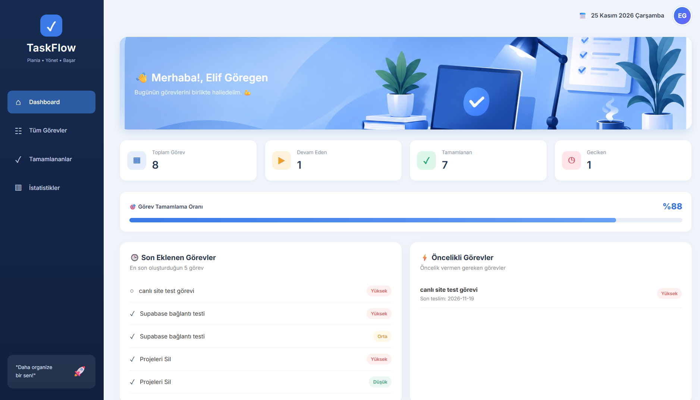
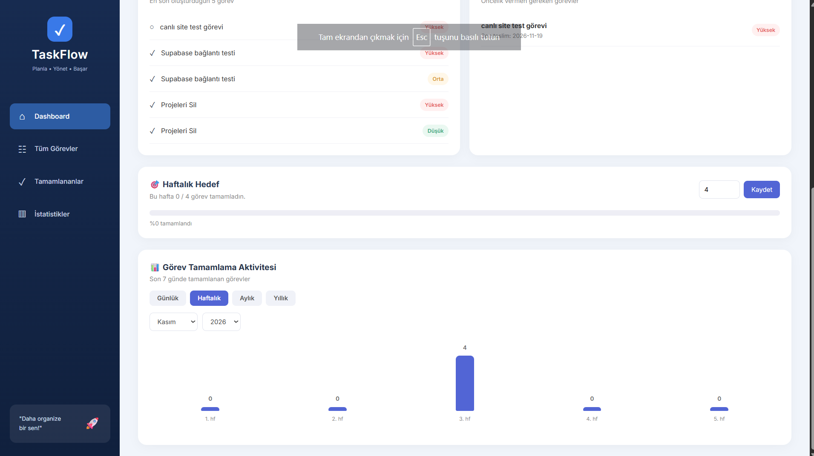
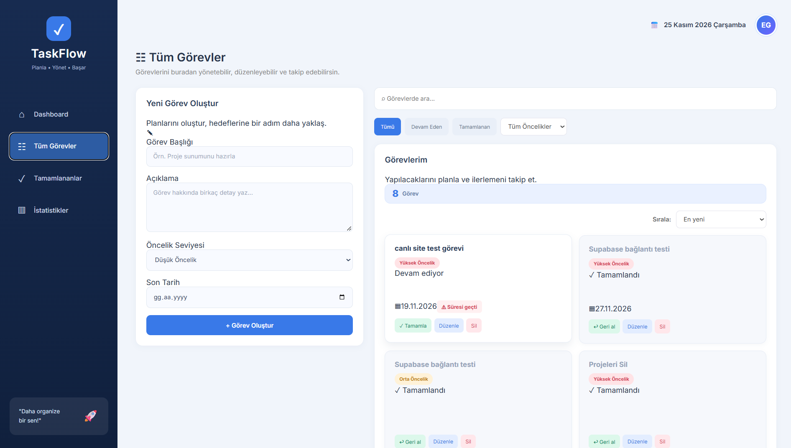
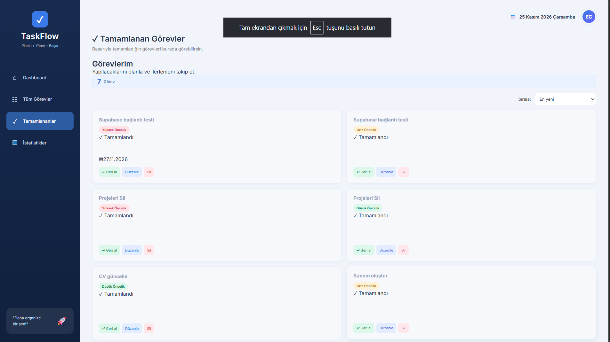
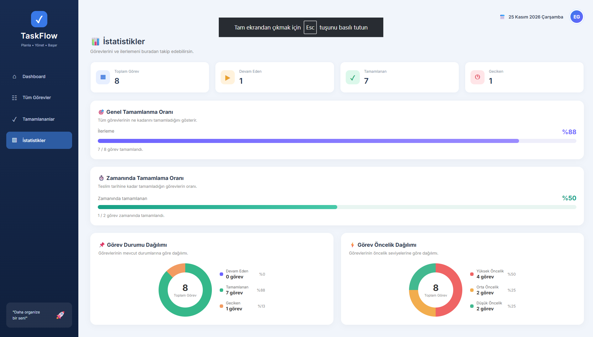
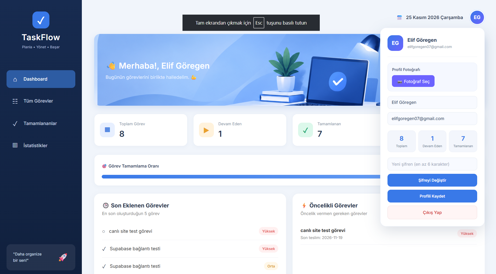

# TaskFlow – Görev Yönetim Uygulaması

TaskFlow, kullanıcıların görevlerini kolayca yönetmelerini, önceliklendirmelerini ve ilerlemelerini takip etmelerini sağlayan modern bir görev yönetim uygulamasıdır.

🌐 **Canlı Demo:** https://taskflow-frontend-five-iota.vercel.app

## ✨ Özellikler

- Kullanıcı kayıt, giriş ve çıkış işlemleri
- Görev oluşturma, düzenleme ve silme
- Görevleri tamamlama ve tamamlanma durumunu geri alma
- Görev önceliği ve son tarih belirleme
- Görev arama, filtreleme ve sıralama
- Dashboard ve görev istatistikleri
- Haftalık hedef belirleme ve ilerleme takibi
- Günlük, haftalık, aylık ve yıllık aktivite grafikleri
- Profil bilgilerini ve profil fotoğrafını düzenleme
- Şifre değiştirme
- Mobil uyumlu responsive tasarım

## 🛠️ Kullanılan Teknolojiler

### Frontend
- React
- JavaScript
- Vite
- CSS

### Backend & Database
- Supabase
- PostgreSQL
- Supabase Authentication
- Supabase Storage

### Tools
- Visual Studio Code
- Git & GitHub
- Vercel

## 🚀 Kurulum

Projeyi bilgisayarınıza klonlayın:

```bash
git clone https://github.com/ElifGoregen/TASKFLOW-FRONTEND.git
```

Proje klasörüne girin:

```bash
cd TASKFLOW-FRONTEND
```

Bağımlılıkları yükleyin:

```bash
npm install
```

Proje ana dizininde `.env` dosyası oluşturun:

```env
VITE_SUPABASE_URL=your_supabase_project_url
VITE_SUPABASE_ANON_KEY=your_supabase_publishable_key
```

Uygulamayı başlatın:

```bash
npm run dev
```

## 🔐 Güvenlik

- Kimlik doğrulama Supabase Authentication ile sağlanır.
- Row Level Security (RLS) politikaları ile kullanıcı verileri korunur.
- Kullanıcılar yalnızca kendi görev ve hedef verilerine erişebilir.
- Gizli servis anahtarları GitHub üzerinde paylaşılmaz.

## 📱 Responsive Design

Uygulama masaüstü, tablet ve mobil cihazlarla uyumlu olacak şekilde geliştirilmiştir.

## 👩‍💻 Geliştirici

**Elif Göregen**

GitHub: https://github.com/ElifGoregen

## Screenshots

### Dashboard




### Tasks


### Completed Tasks


### Statistics


### Profile
